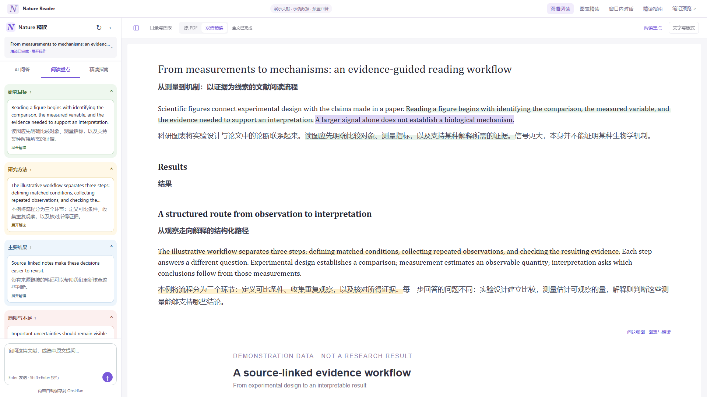
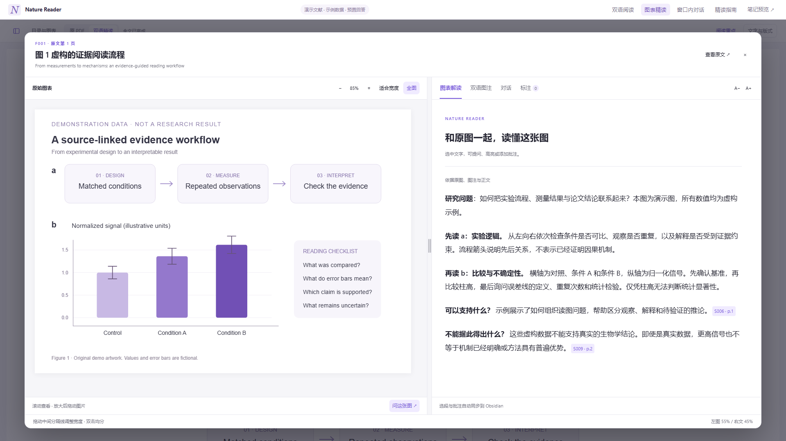
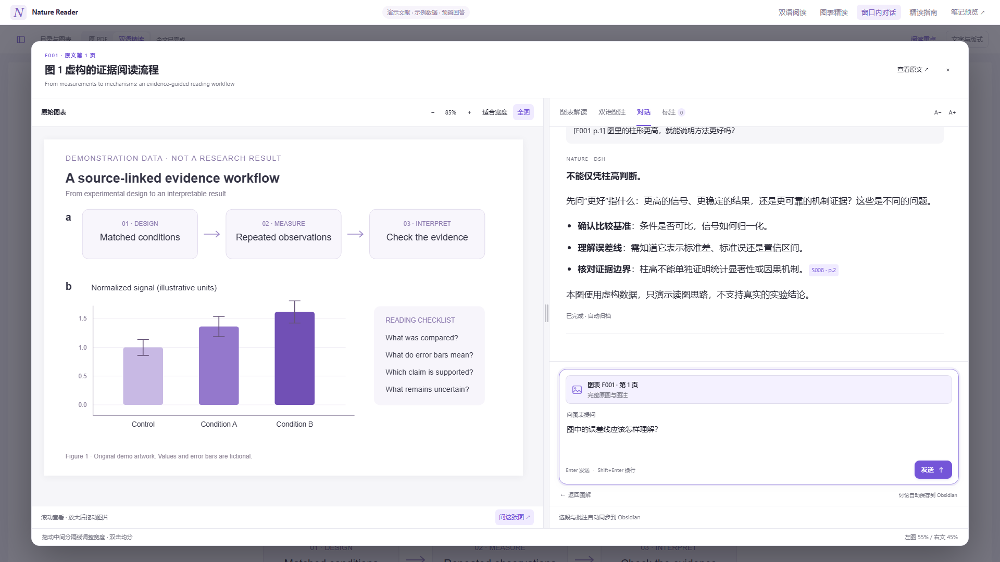
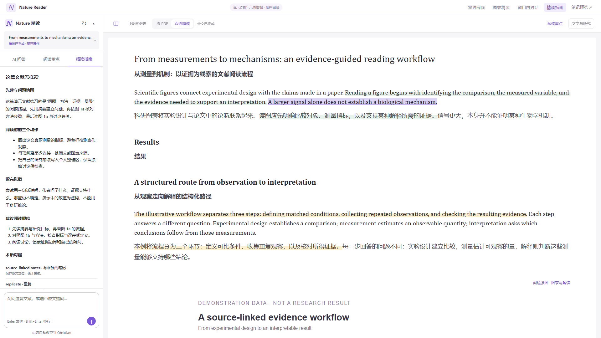

# Zotero Nature Reader

**在 Zotero 读懂论文，把思考留在 Obsidian。**

全文逐段中英对照、图表并排精读、DSH 文献问答与原生标注，自动归档到“一篇文献一篇笔记”。

[下载安装包](https://github.com/sjc88661/zotero-nature-reader/releases/latest) · [安装指南](docs/INSTALL.md) · [交互演示](#交互演示与宣传素材) · [更新记录](CHANGELOG.md) · [English](README_EN.md)



## 可以做什么

- **中英对照全文**：英文在上、中文在下，保留图表和来源定位；支持纸宽、字体和主题设置。
- **图表独立阅读**：左图右文、独立滚动、拖动调宽、缩放；窗口内即可提问并查看回答。
- **有来源的精读**：阅读指南、分类重点、图表阅读提示，沿用已有内容。
- **直接标注**：双语选段高亮与批注保存为 Zotero 原生标注，支持编辑、删除、撤销。
- **自动归档**：全文、指南、图解、讨论及标注写入同一篇 Obsidian 文献笔记；Obsidian 关闭时也能保存。
- **中断恢复**：独立文献会话、稳定记录 ID、增量保存、本地队列和重试。




## 安装概览

当前首发版本面向 **Windows**。阅读插件清单适配 Zotero 10–11，开发环境实际验证于 Zotero 10；其他平台未作安装验收。

需要：Zotero、Obsidian 笔记库、已配置默认模型的 DeepSeek Harness、Node.js 22.19+、Python 3.11+，以及外部 `nature-reader` / `nature-shared` 技能目录。图像理解取决于当前模型能力。

1. 从 GitHub Releases 下载 `zotero-nature-reader-0.2.9.xpi` 和 `obsidian-literature-bridge-0.3.4.xpi`；两者都安装到 **Zotero**。
2. 在 **工具 → Obsidian 文献笔记** 中选择自己的 Obsidian 库目录；发布版没有预设个人库路径。
3. 将源码解压到固定目录，运行 `scripts/setup-python.ps1`，准备外部 Nature 技能，再运行 `scripts/install-harness.ps1`，重启 Harness。
4. 在 Zotero 打开文本型 PDF，点击 **Nature 精读 → 开始精读**。

完整步骤、技能目录结构与故障处理见 [安装指南](docs/INSTALL.md)。这是 Zotero 插件与 DSH 配套端，**不需要安装 Obsidian 插件**；Awesome GPT 仅在需要归档它的讨论或使用其整理功能时另行安装。

## 交互演示与宣传素材

```powershell
node demo/server.mjs
```

打开终端输出的本机地址，可体验正式前端的双语视图、图表窗口、选段工具条及提问布局。演示使用本项目原创的虚构文献与示例数值，回答预先编写，不连接模型、Zotero 或真实笔记库。




截图采用 1920×1080；`media/` 还包含视频分镜和口播稿。宣传时请保留“演示文献 / 示例数据”的说明。正式使用中的回答由配置的模型实时生成。

## 开发

```powershell
npm test
npm run test:bridge
npm run build
```

构建需要 Windows PowerShell 与 Node.js，两个 XPI 输出到根目录 `dist/`。Python 依赖见 `backend/requirements.txt`；模型、技能和 Python 二进制不随 XPI 分发。

| 目录 | 内容 |
|---|---|
| `addon/` | Zotero 阅读界面、选段与标注、DSH 连接 |
| `backend/` | DSH 配套服务、PDF 提取、来源映射与生成状态 |
| `bridge/` | Obsidian 统一归档插件与 Awesome GPT 适配器 |
| `demo/` | 可公开运行的虚构文献演示 |
| `media/` | 宣传截图、分镜与口播 |

## 首版边界

文本型 PDF 和典型双栏论文优先；扫描件需先完成 OCR，复杂公式保留原图。坐标不可靠时回退到页级定位。全文与图表解释仍需结合原文核查。当前采用手动安装更新，清单中的回环 HTTPS 更新地址没有部署在线更新服务。

代码、原创演示内容及宣传素材采用 [MIT](LICENSE)。外部技能及 Python、Zotero、Harness 等组件遵循各自许可，见 [第三方说明](THIRD_PARTY.md)。
